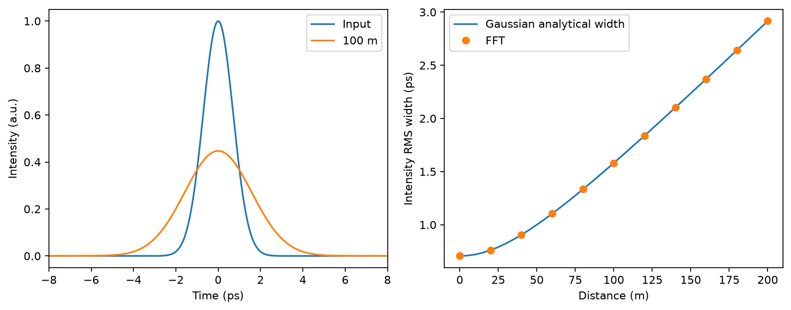

# Pulse dispersion — OptiIA Consulting

Simulate Gaussian pulse broadening under second-order dispersion.

An executable project example using generated data. Images and graphs below are generated by the included code.



## Run

Python 3.12 recommended:
```bash
python -m pip install -r requirements.txt
python -m unittest -v test_analysis
python analysis.py --seed 42 --out results
```

The script writes plots, a data export and JSON metrics to `results/`. The committed `metrics.json` and `preview.png` correspond to seed 42. Import the functions in `analysis.py` to process your own compatible arrays.

## Method

Propagate a complex envelope with an FFT-domain quadratic phase exp(-i beta2 L omega² / 2). Time is in ps, beta2 in ps²/km and distance in km. Compare intensity RMS width against the analytical Gaussian result and verify discrete energy conservation.

## Assumptions and limitations

Linear, lossless second-order dispersion only. No Kerr nonlinearity, loss, third-order dispersion or carrier-resolved field. Periodic FFT boundaries must be far from the broadened pulse. The Gaussian parameter is the amplitude-envelope width, so input intensity RMS width is T0/sqrt(2).

Synthetic results establish reproducibility of this example, not performance on real instruments. No proprietary source code, data or photographs are included.

## Validation

Four tests exercise exact reference cases, independent data or noise realizations, and input validation. See `test_analysis.py` for thresholds and checks.

## Related activities

Scientific computing, instrumentation data analysis, image processing and Python automation.

[More project examples](https://github.com/yaghi-ali) · [OptiIA Consulting](https://www.optiia-consulting.fr) · contact@optiia-consulting.fr
